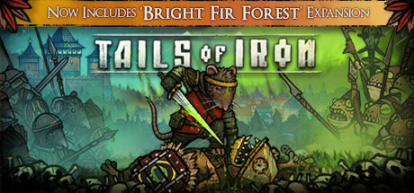

# مُستودع التعريبات العربية للألعاب 🎮
### Arabic Game Localizations Hub

**تعريبات عربية متقنة وشاملة للألعاب مع برامج تثبيت ذكية وسهلة بضغطة زر واحدة.**

---

## 📥 جدول التحميل المباشر للتعريبات

| اللعبة | صورة الغلاف | الحجم | رابط التحميل المباشر |
| :--- | :---: | :---: | :---: |
| **Marvel's Spider-Man Remastered** |  | **114 MB** | [⬇️ **تحميل التعريب**](https://github.com/9jfcc/Ta3reebat/releases/download/v1.0.0/SpiderMan_Remastered_Arabic.zip) |
| **Tails of Iron** |  | **113 MB** | [⬇️ **تحميل التعريب**](https://github.com/9jfcc/Ta3reebat/releases/download/v1.0.0/Tails_of_Iron_Arabic.zip) |
| **Anomaly Agent** |  | **249 MB** | [⬇️ **تحميل التعريب**](https://github.com/9jfcc/Ta3reebat/releases/download/v1.0.0/Anomaly_Agent_Arabic.zip) |
| **Anomaly President** |  | **298 MB** | [⬇️ **تحميل التعريب**](https://github.com/9jfcc/Ta3reebat/releases/download/v1.0.0/Anomaly_President_Arabic.zip) |

---

## 🎮 تفاصيل الألعاب ومميزات التعريب

### 1. Marvel's Spider-Man Remastered
* **الوصف**: تعريب كامل وشامل لقصة وحوارات وقوائم ومهام لعبة مارفل سبايدر مان.
* **المميزات**:
  * تعريب النصوص والحوارات وقوائم التطوير والترقيات.
  * تعديل نظيف لملفات الأرشيف (`toc` و `mod0`).
  * متوافق مع نسخ Steam ونسخ الـ Repack (مثل DODI).
  * نسخ احتياطي واستعادة بضغطة زر.
* **التحميل**: [SpiderMan_Remastered_Arabic.zip](https://github.com/9jfcc/Ta3reebat/releases/download/v1.0.0/SpiderMan_Remastered_Arabic.zip)

---

### 2. Tails of Iron
* **الوصف**: تعريب شامل لقصة ومغامرة الفأر ريجي، يشمل القوائم والمهام والحوارات والأسلحة.
* **المميزات**:
  * خط عربي متصل بالكامل وبدون أي تقطيع.
  * محاذاة دقيقة ومريحة لإحصائيات العتاد والمقاومات.
  * تنسيق متوازن لبطاقات المهام اليومية وقوائم الحدادة.
* **التحميل**: [Tails_of_Iron_Arabic.zip](https://github.com/9jfcc/Ta3reebat/releases/download/v1.0.0/Tails_of_Iron_Arabic.zip)

---

### 3. Anomaly Agent
* **الوصف**: تعريب كامل للحوارات، شجرة المهارات، شاشات التطوير والقوائم.
* **المميزات**:
  * خط عربي مدمج عالي الوضوح متناسق مع فن البكسل.
  * دعم كامل للكتابة والاتجاه من اليمين إلى اليسار (RTL).
  * معالجة دقيقة لجميع المتغيرات والأرقام وأسماء الشخصيات.
* **التحميل**: [Anomaly_Agent_Arabic.zip](https://github.com/9jfcc/Ta3reebat/releases/download/v1.0.0/Anomaly_Agent_Arabic.zip)

---

### 4. Anomaly President
* **الوصف**: تعريب شامل للعبة الرئاسة والاستراتيجية مع إصلاحات محاذاة النص.
* **المميزات**:
  * ظهور سليم لكافة عناوين مناطق خريطة العالم.
  * توسيط تلقائي لأزرار الاختيارات والتأكيد (نعم / لا).
  * دعم كتابة متصلة وسلسة بالكامل.
* **التحميل**: [Anomaly_President_Arabic.zip](https://github.com/9jfcc/Ta3reebat/releases/download/v1.0.0/Anomaly_President_Arabic.zip)

---

## 🛠️ طريقة التثبيت والاستعادة

كل لعبة تأتي مع **برنامج تثبيت مخصص وخفيف** يتيح لك تثبيت التعريب أو إزالته بكل سهولة:

1. **التحميل**: حمّل ملف الـ `.zip` الخاص باللعبة التي تريدها من الجدول أعلاه.
2. **فك الضغط**: استخرج محتويات الملف في أي مكان تريده.
3. **التشغيل**: شغّل برنامج التثبيت (مثل `SpiderMan_Installer.exe`).
4. **التثبيت**:
   * سيكتشف البرنامج مجلد اللعبة تلقائياً (أو يمكنك تحديده عبر زر «استعراض...» أو سحب مجلد اللعبة وإفلاته داخل البرنامج).
   * اضغط على **«تثبيت التعريب الآن»**.
5. **الاستعادة**: إذا رغبت بالعودة للنسخة الأصلية في أي وقت، افتح البرنامج واضغط على **«استعادة الأصل»**.

---

**أتمنى لكم تجربة لعب ممتعة باللغة العربية! 🌟**

